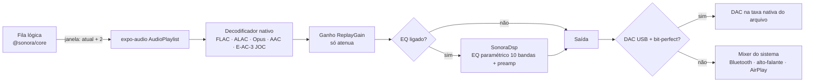

# Sonora — Motor de áudio

Objetivo: **fidelidade máxima e baixa latência**, claramente acima dos ~320 kbps com perda do Spotify.

## 1. Cadeia de reprodução



Arquivos: `apps/mobile/src/player/engine.ts` (motor), `player/caps.ts` (capacidades), `player/dsp.ts` (ponte do EQ/bit-perfect), `packages/core/src/quality.ts` (escolha de fonte e normalização).

## 2. Qualidade

| Nível | Codec | Detalhe |
|---|---|---|
| Economia | Opus/AAC | ≤ 128 kbps |
| Alta | Opus/AAC | ≤ 320 kbps |
| Lossless | FLAC/ALAC | 16-bit/44,1 kHz (CD) |
| Hi-Res | FLAC/ALAC | até 24-bit/192 kHz |
| Máxima | Original | até 32-bit/384 kHz, sem transcodificação |
| Espacial | E-AC-3 JOC (Dolby Atmos) | quando disponível e "Preferir Dolby Atmos" ligado |

`pickSource` escolhe a fonte de **maior fidelidade** permitida pela preferência (Wi-Fi, celular e download separados) e pelas capacidades do aparelho; **nunca faz upsampling falso** — se a faixa só existe em 16/44.1, é isso que toca, e o selo na UI mostra exatamente o formato real (`24-bit/192 kHz FLAC`, `Dolby Atmos`, `AAC 256`).

Decodificação: ExoPlayer/Media3 (Android) e AVFoundation (iOS 11+) decodificam FLAC e ALAC nativamente, em hardware quando disponível — baixo consumo de bateria.

## 3. Gapless

O `AudioPlaylist` do expo-audio é gapless (Media3 playlist no Android, AVQueuePlayer no iOS). O motor mantém no player nativo uma **janela** com a faixa atual + as 2 próximas da fila lógica. Quando uma faixa termina, a próxima já está decodificada e o player nativo emenda sem silêncio, mesmo com a tela bloqueada e sem depender do JS. O JS só recebe `trackChanged`, avança a fila lógica, registra o `PlayEvent` e completa a janela.

Mudanças na fila (tocar a seguir, reordenar, shuffle) chamam `reconcileLookahead()`, que só reescreve as posições futuras da janela — a faixa atual nunca é interrompida.

## 4. Normalização de volume

ReplayGain 2.0 (ganho por faixa e por álbum + pico), com modo **Automático**: ganho de álbum quando se ouve um álbum inteiro (preserva a dinâmica entre faixas), ganho de faixa em playlists/shuffle. Alvo configurável (-23, -16, -14, -11 LUFS).

O ganho é limitado pelo pico (`1/peak`) e o volume aplicado é ≤ 1: **só atenuamos, nunca fazemos boost digital nem compressão de dinâmica** — o oposto do "loudness" agressivo de outros serviços.

## 5. Equalizador e saída bit-perfect — módulo nativo `SonoraDsp`

O EQ precisa estar dentro do pipeline de áudio nativo. O app já tem a UI, presets, persistência e a ponte JS (`requireOptionalNativeModule('SonoraDsp')`); em builds sem o módulo, o áudio sai sem processamento (o que, por definição, é bit-perfect até o mixer).

### Android (Kotlin, Expo Modules API + Media3)

```kotlin
// modules/sonora-dsp/android/.../SonoraDspModule.kt (esboço)
class SonoraDspModule : Module() {
  override fun definition() = ModuleDefinition {
    Name("SonoraDsp")
    Function("setEqualizer") { enabled: Boolean, gainsDb: List<Double>, preampDb: Double ->
      ParametricEq.shared.configure(enabled, gainsDb, preampDb)
    }
    AsyncFunction("setBitPerfect") { enabled: Boolean ->
      // Android 14+: AudioManager.setPreferredMixerAttributes(attrs, usbDevice,
      //   AudioMixerAttributes.Builder(format).setMixerBehavior(MIXER_BEHAVIOR_BIT_PERFECT).build())
      BitPerfect.apply(appContext.reactContext!!, enabled)
    }
    AsyncFunction("getOutputInfo") { BitPerfect.currentOutput(appContext.reactContext!!) }
  }
}

// Biquads peaking (RBJ Audio EQ Cookbook) em float64, por canal, inseridos como
// androidx.media3.common.audio.AudioProcessor na cadeia do ExoPlayer
// (DefaultAudioSink.Builder().setAudioProcessors(arrayOf(ParametricEq.shared))).
// Quando enabled=false, isActive() retorna false e o processador é removido da cadeia.
```

- **Bit-perfect USB**: no Android 14+ (`AudioMixerAttributes` com `MIXER_BEHAVIOR_BIT_PERFECT`) o stream vai ao DAC na taxa/profundidade do arquivo, sem resampling nem mistura. Com EQ ligado, o bit-perfect é desativado automaticamente (EQ altera as amostras por definição).
- Requer que o expo-audio permita injetar o `AudioSink` (via config plugin/patch) **ou** que o módulo assuma a reprodução com seu próprio `ExoPlayer` + `MediaSessionService` — esse segundo caminho também habilita Android Auto (ver §7).

### iOS (Swift)

```swift
// Esboço: AVAudioEngine com AVAudioUnitEQ(numberOfBands: 10)
// player.scheduleSegment(...) para gapless; bandas .parametric com
// bandwidth 1.0 oitava; globalGain = preampDb.
// Com EQ desligado, usa-se AVQueuePlayer direto (caminho mais curto até o DAC).
// AVAudioSession.setPreferredSampleRate(arquivo.sampleRate) para DACs externos (Lightning/USB-C).
```

## 6. Latência

- Início de reprodução: a primeira faixa começa a tocar com o buffer mínimo do player; as próximas já estão pré-carregadas (janela de 3).
- Troca manual para a próxima faixa: `native.next()` sobre item já em buffer → instantâneo.
- Seek: `seekTo` nativo; em FLAC com SEEKTABLE é preciso ao frame.
- Downloads tocam do disco local (prioridade sobre a rede) → zero latência de rede.

## 7. Saídas externas

| Saída | Status | Implementação |
|---|---|---|
| Fones/alto-falante | ✅ | Nativo. |
| Bluetooth (AVRCP) | ✅ | Controles de mídia/lock screen via `setActiveForLockScreen` (MediaSession/Now Playing). Codec BT (LDAC/aptX/AAC) é negociado pelo sistema. |
| Tela de bloqueio, fone com botões, relógio | ✅ | Mesma MediaSession. |
| AirPlay | ✅ básico | AVPlayer roteia para AirPlay pelo seletor do sistema (Central de Controle). Botão dedicado: `AVRoutePickerView` via módulo nativo pequeno. |
| Chromecast | 🛠️ planejado | `react-native-google-cast` + Default Media Receiver (FLAC é suportado pelo Cast). A fila lógica do core é espelhada no `RemoteMediaClient`. |
| Android Auto | 🛠️ planejado | `MediaLibraryService` (Media3) expondo a árvore Biblioteca/Playlists/Mixes; reaproveita o módulo nativo de §5. |
| CarPlay | 🛠️ planejado | `CPTemplateApplicationScene` com listas de templates; requer entitlement de áudio da Apple. |

## 8. Por que soa melhor que 320 kbps

- FLAC é **matematicamente idêntico** ao master entregue; não há artefatos de codificação perceptual (pré-eco em transientes, perda acima de ~16 kHz, imagem estéreo "achatada").
- Masters hi-res (24-bit) têm ~144 dB de faixa dinâmica teórica vs. ~96 dB do CD; em gravações de qualidade isso significa piso de ruído mais baixo e decaimentos de reverberação preservados.
- Sem compressão de loudness na normalização, sem crossfade forçado, gapless real.
- O caminho bit-perfect com DAC externo evita o resampling do mixer do Android (tipicamente fixo em 48 kHz).
