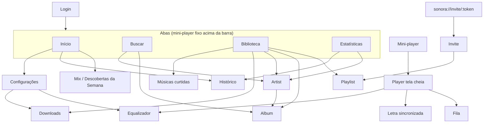

# Sonora — Telas e fluxos

Interface escura por padrão, limpa e sem anúncios, banners, upsells ou faixas inseridas sem o usuário pedir. Todas as telas ficam em `apps/mobile/src/app/` (expo-router: cada arquivo é uma rota).

## Mapa de navegação

## Telas

| Tela | Arquivo | O que tem |
|---|---|---|
| Login | `login.tsx` | Entrar / criar conta. |
| Início | `(tabs)/index.tsx` | Saudação, atalhos para playlists, **Tocadas recentemente**, **Descobertas da Semana**, **Daily Mixes**; acesso a histórico e configurações. Estado offline com aviso. |
| Buscar | `(tabs)/search.tsx` | Busca com debounce, abas Tudo/Músicas/Álbuns/Artistas, **filtros avançados** (gênero, faixa de anos, Lossless/Hi-Res/Atmos, **buscar na letra**), sintaxe `artist:` `year:` etc., buscas recentes, navegar por gênero. |
| Biblioteca | `(tabs)/library.tsx` | Músicas curtidas, Baixadas, playlists (normal, colaborativa, inteligente), álbuns salvos, artistas seguidos; filtros e ordenação (recentes / A-Z); criar playlist. |
| Estatísticas | `(tabs)/stats.tsx` | Hoje / 7 dias / 30 dias / ano / sempre: minutos e horas, plays, músicas e artistas únicos, **streak atual e recorde**, taxa de skip, gráfico de barras, top artistas, top músicas, gêneros, **mapa de calor dia×hora**, destaques (dia de pico, hora favorita, artistas novos). |
| Player | `player.tsx` | Capa grande, título/artista, curtir, barra de progresso com arraste (e ações de acessibilidade ±10 s), selo de qualidade real, shuffle, anterior, play/pause, próxima, repeat (off/all/one), **velocidade 0,5×–2×**, **timer de sono**, letra, EQ, fila. |
| Fila | `queue.tsx` | Tocando agora, **Próximas na fila** (fila do usuário) e **A seguir do contexto**, ambas com **arrastar e soltar**, remover, pular para item; autoplay (rádio ao fim) liga/desliga. |
| Letra | `lyrics.tsx` | Letra sincronizada com rolagem automática e destaque da linha; tocar numa linha faz seek; fallback para letra não sincronizada. |
| Álbum | `album/[id].tsx` | Capa, tipo/ano/duração/qualidade, discos, salvar, baixar, tocar/aleatório, gravadora. |
| Artista | `artist/[id].tsx` | Seguir, rádio do artista, **Mais ouvidas**, discografia, singles e EPs, coletâneas, **artistas relacionados**, biografia. |
| Playlist | `playlist/[id].tsx` | Tocar/aleatório, editar (renomear, **arrastar e soltar**, remover), ordenar (título/artista/data), baixar tudo, compartilhar, **convidar colaboradores**, tornar colaborativa/pública, excluir, **recomendadas para esta playlist**. Também atende *Músicas curtidas* e playlists **inteligentes** (regras avaliadas no aparelho). |
| Mix | `mix/[id].tsx` | Discover Weekly / Daily Mix: tocar, baixar, salvar como playlist. |
| Configurações | `settings.tsx` | Qualidade Wi-Fi / celular / download (até "Máxima"), gapless, preferir Atmos, normalização (modo e alvo LUFS), **bit-perfect USB**, info da saída, armazenamento, sair. |
| Equalizador | `equalizer.tsx` | 10 bandas (31 Hz–16 kHz, ±12 dB), presets, preamp automático anti-clipping. |
| Baixadas | `downloads.tsx` | Lista offline, espaço usado/livre, apagar individual ou tudo. |
| Histórico | `history.tsx` | Histórico completo agrupado por dia com total ouvido por dia. |
| Convite | `invite/[token].tsx` | Aceita convite e abre a playlist colaborativa. |

O menu de ações de faixa (toque longo ou ⋮ em qualquer música — `components/TrackSheet.tsx`) oferece: curtir, **tocar a seguir**, **adicionar à fila**, adicionar à playlist (ou criar nova), **rádio da música**, baixar/remover download, ver álbum, ver artista(s), compartilhar.

## Fluxos principais

### 1. Escolher exatamente o que ouvir
Buscar → tocar uma faixa (o contexto vira a lista de resultados) → toque longo em outra → **Tocar a seguir** → abrir Fila → arrastar para a ordem desejada. Shuffle e repeat são opcionais e nunca ligam sozinhos; o autoplay ao fim da fila é visível e desligável.

### 2. Criar e organizar uma playlist
Biblioteca → **+** → Playlist → em qualquer música, *Adicionar à playlist* → na playlist, **Editar** → arrastar pela alça ≡ (ou ações de acessibilidade "mover para cima/baixo") → renomear → *Ordenar por…* se quiser. Cada movimento grava uma única chave fracionária e sincroniza.

### 3. Playlist colaborativa
Biblioteca → **+** → Colaborativa (ou *Tornar colaborativa* numa existente) → **Convidar** → link `sonora://invite/<token>` (7 dias) → o amigo abre o link → vira editor → as edições de ambos se fundem por HLC, inclusive feitas offline.

### 4. Playlist inteligente
Biblioteca → **+** → Inteligente (ex.: "curtidas em Hi-Res, por mais tocadas"). Regras: gênero, ano, artista, nº de plays, curtida, dias desde a última escuta, qualidade (lossless/hi-res/atmos); combinação *todas/qualquer*; ordenação e limite. Reavaliada ao abrir.

### 5. Ouvir offline
Álbum/playlist/mix → **Baixar** → arquivos no codec original escolhido em *Downloads* → sem rede, o player usa o arquivo local automaticamente; histórico e estatísticas continuam sendo registrados e são enviados quando a rede voltar.

### 6. Ver minhas estatísticas
Aba Estatísticas → escolher o período → minutos/horas, streak, tops, gêneros, mapa de calor → tocar num artista para abrir a página → *Ver histórico completo*.

### 7. Trocar de dispositivo
Entrar com a mesma conta → biblioteca, playlists, curtidas, configurações de áudio e estatísticas aparecem (pull por escopo + histórico consolidado no servidor).

## Acessibilidade
- Todos os controles têm `accessibilityLabel`/`role`; alvos de toque ≥ 44 pt.
- Barra de progresso, sliders do EQ e alças de reordenação são `adjustable` com ações de incremento/decremento (leitores de tela não dependem de arrasto).
- Contraste alto (texto #F5F5F7 sobre #0A0A0C), estado "tocando agora" anunciado nas linhas.
- Gráficos têm resumo textual acessível.
