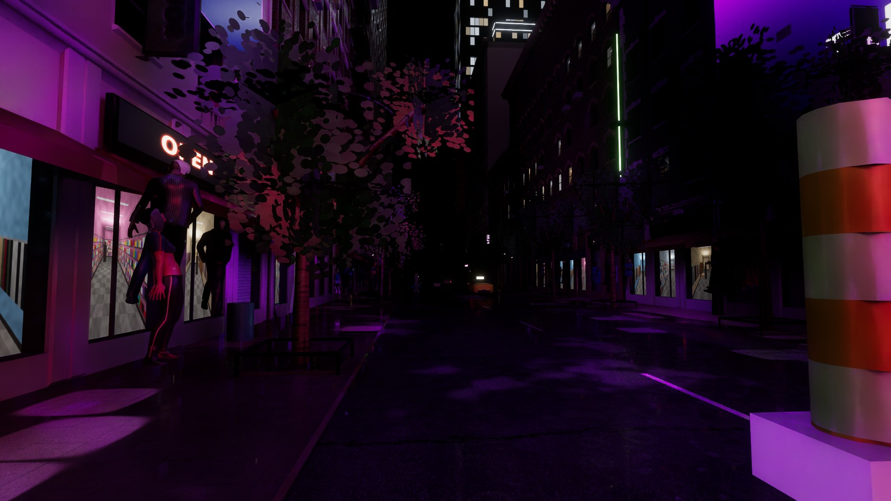
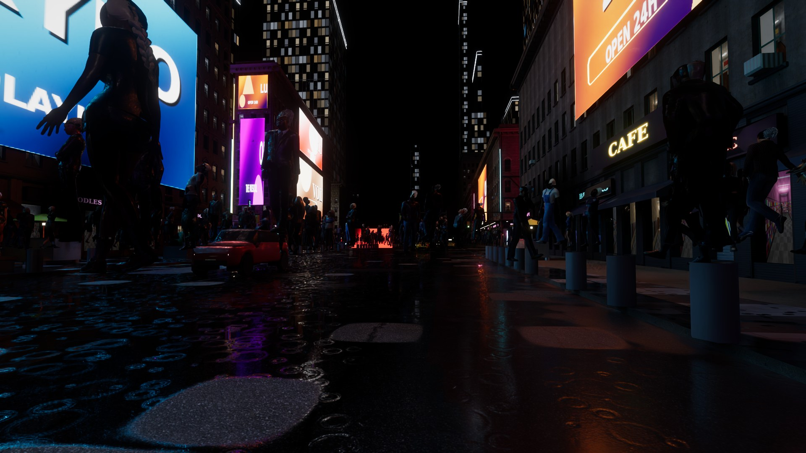
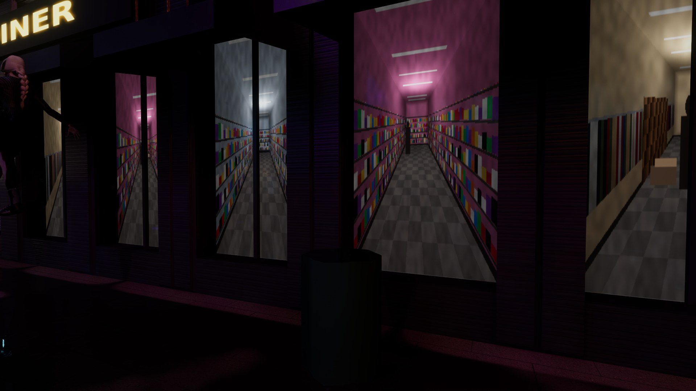
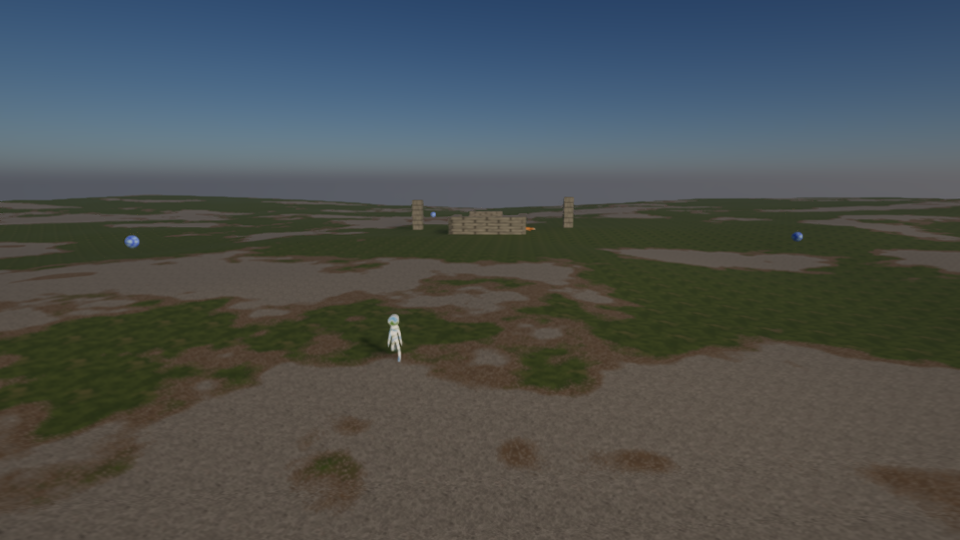
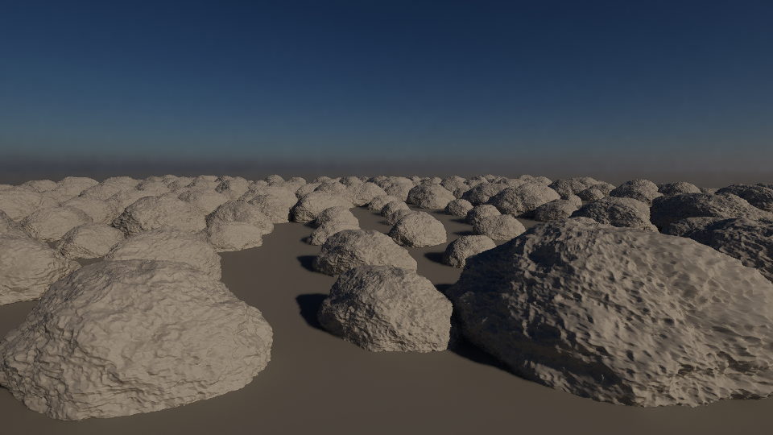

# Legacy Engine

Motor de jogos em **C++20 + Vulkan 1.3** com **ray tracing em tempo real**: renderizador físico, editor visual,
física, áudio, scripts, rede e ferramentas de mundo aberto num executável só. É nele que roda o **Times Square**,
uma Nova York à noite, com chuva, neons, trânsito e multidão.



| | |
|---|---|
|  |  |
| A praça à noite: telões, neons e chuva | Interior de loja com luz e reflexos traçados |
|  |  |
| Vale dos Cristais, o jogo de demonstração | Geometria virtualizada: milhões de triângulos com LOD por pixel |

## Desempenho

Medido numa **RTX 3070 Ti em 1080p** (preset Médio), com a imagem comparada a uma referência por path tracing:

| Cena | Tempo de GPU por quadro |
|---|---|
| Sponza | 9,6 ms |
| Bistro (1,75 milhão de triângulos, 97 luzes) | 16,7 ms |
| Vale dos Cristais (preset Alto) | 9,8 ms |

## Renderização

| Sistema | Como funciona |
|---|---|
| Ray tracing | BLAS/TLAS reconstruídos na GPU a cada quadro, `VK_KHR_ray_query`, teste de alfa (folhagem, grades) |
| Milhares de luzes | **ReSTIR DI** (reuso temporal e espacial), BVH de luzes, **luzes de malha** (cada triângulo emissivo é uma luz) |
| Iluminação global | Rebotes difusos traçados + cache de radiância; sem ray tracing, **sondas de irradiância** assadas |
| Reflexos | Traçados por raio (GGX, amostragem VNDF), com reflexo de reflexo pelo cache |
| Sombras | Traçadas por raio, penumbra física do sol e de cada luz |
| Denoiser | **DLSS Ray Reconstruction** em RTX; **NRD ReLAX/ReBLUR** ou **SVGF** próprio nas outras placas |
| Upscaling | **DLSS 4**, **FSR 3** ou **TAAU** próprio (reconstrução gaussiana, clipping YCoCg, RCAS) |
| Materiais | PBR glTF completo: metal/rugosidade, especular, IOR, compensação de energia, **vidro** traçado, **pintura de carro** com verniz e flocos metálicos, **materiais por nós** |
| Pele, cabelo, tecido | Pele com espalhamento subsuperficial, cabelo **por fios** com física, tecido com colisão consigo mesmo |
| Céu e clima | Atmosfera física (Rayleigh, Mie, ozônio), lua e estrelas, **nuvens volumétricas**, névoa com god rays, **chuva** com superfícies molhadas, poças com reflexo e respingos |
| Água | Oceano com ondas na geometria |
| Pós-processamento | Auto-exposição por histograma, bloom físico, profundidade de campo com autofoco, motion blur, lens flare, tonemap ACES |
| Unidades físicas | Sol em lux, luzes em candela, emissão em nits, exposição em EV100 |

## Escala de mundo aberto

| Sistema | Como funciona |
|---|---|
| Geometria virtualizada | DAG de clusters com LOD escolhido por erro em pixel, desenhado com **mesh shaders** |
| Culling | Oclusão HiZ em duas fases; HLOD de quarteirões distantes num objeto só |
| Mundo aberto | Células carregadas e descarregadas pela distância, **terreno de quilômetros**, origem flutuante |
| Streaming | Texturas por mip conforme a câmera, cópia para a GPU fora da thread principal |
| Multidão | Milhares de pessoas sem clones, com LOD e impostores |
| Conteúdo pronto | Texturas BC7/BC5, tangentes e geometria virtualizada são preparadas na geração da versão e vão prontas no download |

## Camada de jogo

| Sistema | Como funciona |
|---|---|
| Mundo | Entidades (EnTT) e cenas em JSON |
| Editor visual | Dear ImGui com gizmos, hierarquia, propriedades, editor de nós e de terreno |
| Scripts | **Lua** com recarga a quente e **script visual** por nós |
| Física | **Jolt**: corpos rígidos, colisão por malha, **veículos**, **ragdoll** e ragdoll ativo |
| Animação | Esqueletos glTF com skinning na GPU, máquinas de estado, mistura, retargeting entre esqueletos, expressões faciais |
| NPCs | Navegação Recast/Detour e comportamentos (patrulhar, perseguir, procurar, fugir, seguir) |
| Cinema | Sequenciador de cutscenes em linha do tempo e câmera de cinema |
| Áudio | Som 3D (miniaudio) |
| Interface | HUD, menus clicáveis, pausa, opções, salvar e carregar o jogo, controle (gamepad), idiomas |
| Partículas | Fogo, fumaça, faíscas e respingos por cena ou script |
| Multijogador | Rede com ENet |
| Assets | glTF 2.0 com meshopt e Draco, texturas PNG/JPG/DDS/KTX2, luzes `KHR_lights_punctual` |
| Exportação | `tools/empacotar.py` gera a pasta do jogo pronta para distribuir |

Detalhes de cada sistema, com exemplos de cena e de script: [docs/motor_completo.md](docs/motor_completo.md).

## Compilar

Requisitos: **CMake 3.30+**, compilador C++20, [Vulkan SDK](https://vulkan.lunarg.com/sdk/home) e Git. As bibliotecas
(VMA, GLM, GLFW, cgltf, stb, Jolt, EnTT, Lua, Dear ImGui, Recast, miniaudio, ENet, NVIDIA NRD, SDK do DLSS e, no
Windows, AMD FidelityFX) são baixadas na primeira configuração. Licenças e créditos em
[docs/licencas.md](docs/licencas.md).

```bash
cd engine
cmake -P tools/fetch_assets.cmake   # cenas de teste (Sponza, Bistro e outras), uma vez só
cmake -S . -B build -DCMAKE_BUILD_TYPE=Release
cmake --build build --config Release -j
```

No Windows, com o Visual Studio 2022 ("Desenvolvimento para desktop com C++"), os mesmos comandos funcionam no
"Developer PowerShell for VS 2022"; o executável fica em `build\Release\legacy.exe`.

Placa de vídeo para ray tracing: NVIDIA RTX 20xx ou mais nova, AMD RX 6000 ou mais nova, ou Intel Arc. Sem ray
tracing, o motor usa as sondas de irradiância.

## Rodar

```bash
./build/legacy --scene cenas/times_square.json      # Times Square
./build/legacy --scene cenas/vale/vale.json         # Vale dos Cristais (jogo de demonstração)
./build/legacy --editor --scene cenas/vale/vale.json  # editor visual
./build/legacy --night                              # Sponza à noite com 512 luzes
./build/legacy --quality medio                      # baixo | medio | alto | ultra | cinema
./build/legacy --upscaler fsr --scale 0.67          # FSR 3 (ou dlss, taau)
./build/legacy --fullscreen
./build/legacy --headless --frames 32 --width 1920 --height 1080 --out foto.png
./build/legacy --help                               # todas as opções
```

Controles: **botão direito + mouse** olha · **WASD** move · **Q/E** desce/sobe · **Shift** rápido · **Esc** pausa.

Testes automáticos: `python tools/testes.py` (validação Vulkan em todos os presets e cenas, fornalha branca,
atmosfera contra path tracing, cintilação) e `python tools/fisica.py`.

## Arquitetura

```
src/
  rhi/        camada sobre Vulkan: contexto, recursos, passes, swapchain, BLAS/TLAS
  scene/      malhas, materiais, luzes, câmera, carregador glTF, geometria virtualizada, compressão de texturas
  renderer/   passes do quadro, ReSTIR, denoisers, upscalers, oceano
  game/       mundo de entidades, física, áudio, scripts, navegação, rede, materiais por nós
  editor/     editor visual e editor de grafos
  core/       carregamento, conta Legacy, caminhos
shaders/      GLSL compilado para SPIR-V no build
cenas/        cenas JSON (Times Square, Vale dos Cristais e testes)
tools/        geradores de cidade e personagens, empacotador, testes
```
