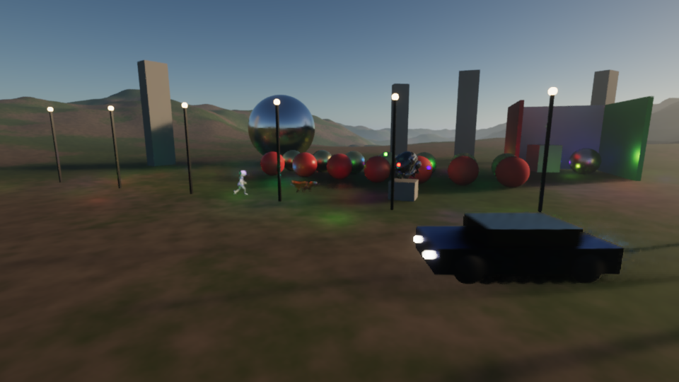
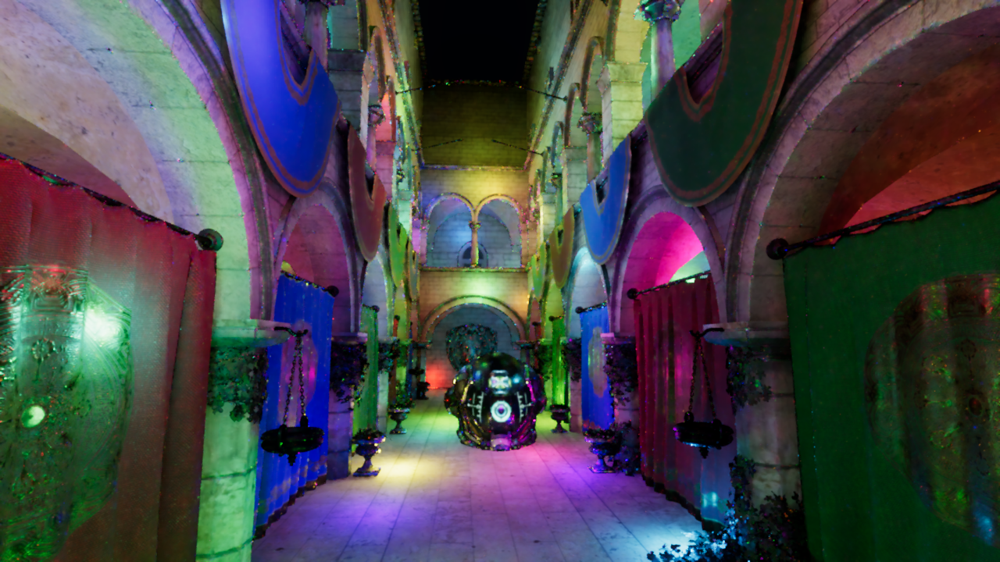
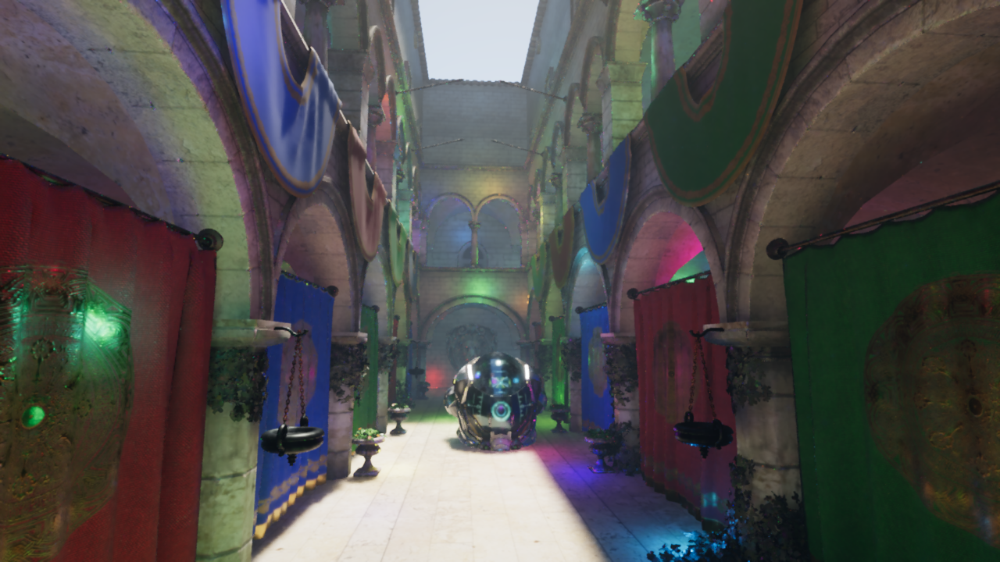
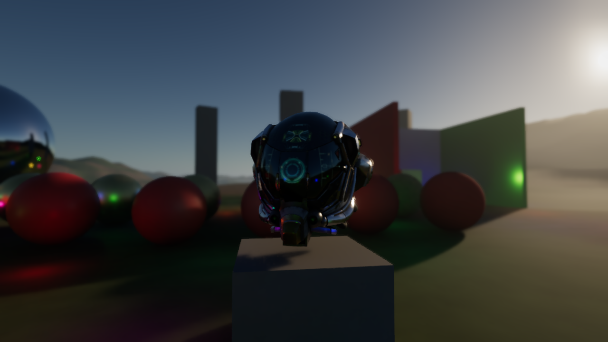

# Legacy Engine

Motor gráfico em **C++20 + Vulkan 1.3** com **ray tracing em tempo real**.

## Meta

Um motor gráfico **completo e de ponta**. A régua tem dois níveis:

1. **Piso obrigatório:** tudo o que o motor gráfico da Rockstar faz no GTA 6, o Legacy faz igual ou melhor —
   se um estúdio fizesse um jogo desse porte com o Legacy, o resultado seria equivalente ou superior.
2. **Objetivo:** ir além — recursos que nenhum motor do mercado tem juntos, todos com qualidade de ponta.

Escopo: o motor gráfico (tudo o que é desenhado na tela). Prioridade absoluta: qualidade.



Vídeos (Dia 3): [Sponza à noite com personagens](docs/videos/dia03_sponza_noite.mp4) · [cena externa com carro](docs/videos/dia03_externa.mp4)



| | |
|---|---|
|  |  |
| Sponza de dia: sol entrando no átrio + GI | Profundidade de campo com autofoco + bloom |

[Dia 1](docs/screenshots/dia01.png) · [Comparação com o motor do GTA 6](docs/gta6-analise.md)

## O que já tem

| Sistema | Técnica | Onde |
|---|---|---|
| RHI Vulkan moderno | Dynamic rendering, synchronization2, push descriptors, texturas bindless, VMA | `src/rhi/` |
| Assets | glTF 2.0 (cgltf), texturas JPG/PNG com mipmaps gerados na GPU, normal maps | `src/scene/gltf_loader.cpp` |
| Renderização | Deferred: G-buffer + iluminação em compute | `src/renderer/` |
| Cena dinâmica | Transformações por frame, vetores de movimento por objeto, TLAS reconstruído na GPU, luzes móveis | `src/renderer/renderer.cpp` |
| Animação esquelética | Esqueletos e clipes glTF, skinning em compute, refit de BLAS (sombras/reflexos seguem a pose) | `shaders/skinning.comp` |
| Ray tracing | BLAS/TLAS + `VK_KHR_ray_query`, com teste de alfa (folhagem, grades) | `shaders/raytracing.glsl` |
| Sombras | Traçadas por raio, penumbra física (sol e luzes) | `shaders/lighting.glsl` |
| Milhares de luzes | **ReSTIR DI**: RIS + reuso temporal e espacial + visibilidade | `shaders/restir*.glsl` |
| Iluminação global | 1 rebote difuso traçado + reflexões VNDF (GGX) | `shaders/lighting.glsl` |
| Denoiser | **SVGF**: acumulação temporal com reprojeção + à-trous guiado por variância | `shaders/svgf_*.comp` |
| Anti-aliasing / upscaling | **TAAU** próprio: jitter Halton, Catmull-Rom, clipping YCoCg; renderiza a 67% | `shaders/taa.comp` |
| Pós-processamento | Auto-exposição por histograma, bloom físico (COD:AW), DOF com autofoco, motion blur, ACES | `shaders/` |
| Materiais | PBR glTF (metálico/rugosidade, especular/glossiness, KHR specular/ior); GGX com compensação de energia (Turquin), difuso com conservação de energia, AA especular | `shaders/brdf.glsl` |
| Céu | Atmosfera física Rayleigh/Mie/ozônio + sky-view LUT (Hillaire 2020) | `shaders/atmosphere.glsl` |
| Câmera | Reverse-Z com plano distante infinito; exposição física em EV100 | `src/scene/camera.h` |
| Unidades físicas | Sol em lux, luzes em candela, emissão em nits, pré-exposição dos alvos HDR | `shaders/frame.glsl` |

Pipeline de um frame:

```
Cena dinâmica (skinning, refit BLAS, TLAS) → Sky LUT → G-buffer → ReSTIR temporal → ReSTIR espacial → Iluminação RT (difuso | especular)
→ SVGF temporal → à-trous ×4 / ×2 → Composição (céu, névoa) → TAAU
→ Auto-exposição → DOF → Motion blur → Bloom → Tonemap ACES
```

## Compilar

Requisitos: CMake 3.24+, compilador C++20, [Vulkan SDK](https://vulkan.lunarg.com/sdk/home) (traz o `glslangValidator`).
VMA, GLM, GLFW, cgltf e stb são baixados automaticamente.

```bash
cd engine
cmake -P tools/fetch_assets.cmake   # baixa Sponza, DamagedHelmet, Fox e CesiumMan (~57 MB, uma vez só)
cmake -S . -B build -DCMAKE_BUILD_TYPE=Release
cmake --build build --config Release -j
```

No Windows, com Visual Studio 2022 instalado, os mesmos comandos funcionam (o executável fica em `build/Release/legacy.exe`).

GPU recomendada para ray tracing: NVIDIA RTX 20xx+, AMD RX 6000+ ou Intel Arc.

### Windows (passo a passo)

1. Instale (todos gratuitos): **Visual Studio 2022 Community** com a carga "Desenvolvimento para desktop com C++",
   **Git** (git-scm.com) e o **Vulkan SDK** (vulkan.lunarg.com/sdk/home — marque os componentes padrão).
   Driver da GPU atualizado (NVIDIA: 550 ou mais novo).
2. No "Developer PowerShell for VS 2022":

```powershell
git clone -b ccr-5423dd89-y3br6e https://github.com/dseronn-code/leagcy.git
cd leagcy\engine
cmake -P tools/fetch_assets.cmake          # ~2,5 GB (Bistro incluído), uma vez só
cmake -S . -B build
cmake --build build --config Release
.\build\Release\legacy.exe
```

O console mostra, a cada 3 segundos, o tempo de GPU de cada passe (ms).

## Rodar

```bash
./build/legacy                             # Sponza, de dia, janela interativa
./build/legacy --night                     # noite: 512 luzes coloridas com sombra (ReSTIR)
./build/legacy --scene outdoor --dof       # cena externa com profundidade de campo
./build/legacy --lights 4000 --night       # teste de estresse de luzes
./build/legacy --quality cinema            # presets: baixo | medio | alto | ultra (padrão) | cinema
./build/legacy --fullscreen                # tela cheia na resolução nativa do monitor
./build/legacy --scale 0.5                 # resolução interna menor (mais FPS, o TAAU reconstrói)
./build/legacy --validation                # camadas de validação do Vulkan (debug)
./build/legacy --headless --frames 32 --width 1920 --height 1080 --out shot.png
./build/legacy --scene outdoor --sun-elevation 3   # pôr do sol (atmosfera física)
./build/legacy --scene shadows --debug-view sol     # depuração: visibilidade crua do sol (sol, sol-luz, nl, normal)
./build/legacy --help                      # todas as opções
```

Testes de regressão (precisa de `pip install numpy pillow`): `python tools/testes.py` roda validação Vulkan em
todos os presets e cenas, fornalha branca, atmosfera contra path tracing, cintilação e pixels inválidos, e diz o
que passou ou falhou (`--rapido` para uma versão curta).

Controles: **botão direito + mouse** olha · **WASD** move · **Q/E** desce/sobe · **Shift** rápido ·
**setas** movem o sol · **+/-** compensação de exposição · **F** liga/desliga DOF · **M** motion blur · **Esc** sai.

## Limitações conhecidas

- Upscaling é o TAAU próprio; DLSS / FSR 3 / XeSS ainda não estão integrados.
- Texturas sobem para a GPU sem compressão (BC7 pendente), então cenas grandes usam bastante VRAM.
- Materiais com transparência (`BLEND`) são tratados como recorte por alfa.
- Sem ray tracing (`--no-rt`) não há sombras; shadow maps em cascata entram depois.
- Animação: morph targets ainda não suportados; interpolação CUBICSPLINE usa só os valores-chave.
- Cada personagem tem sua própria cópia da malha deformável (multidões instanciadas vêm depois).
- Desempenho ainda não foi medido em GPU real (desenvolvido e validado com o driver por software lavapipe).

## Arquitetura

```
src/
  rhi/        camada fina sobre Vulkan (contexto, recursos, passes com push descriptors, swapchain, BLAS/TLAS)
  scene/      malhas, materiais, luzes, câmera, carregador glTF, cenas de demonstração
  renderer/   organização dos passes do frame
  util/       PNG
shaders/      GLSL -> SPIR-V compilado no build (variantes *_rt com ray tracing)
tools/        fetch_assets.cmake
```

## Roadmap

Comparação detalhada com o motor do GTA 6: [docs/gta6-analise.md](docs/gta6-analise.md).

- [x] **Dia 1**: RHI Vulkan, ray tracing, PBR, atmosfera física
- [x] **Dia 2**: denoiser + TAAU, glTF e texturas, pós-processamento de cinema, ReSTIR DI (milhares de luzes)
- [x] **Dia 3**: cena dinâmica (TLAS por frame, vetores de movimento por objeto, luzes móveis), animação esquelética na GPU
- [ ] Escala de mundo aberto: GPU-driven rendering, culling, LOD, streaming
- [ ] Atmosfera viva: nuvens volumétricas, clima, chuva e superfícies molhadas
- [ ] Água: oceano FFT, rios, espuma, cena subaquática
- [ ] Personagens AAA: pele com SSS, cabelo por fios, tecido
- [ ] DLSS / FSR 3, texturas BC7, shadow maps em cascata (fallback sem RT)
