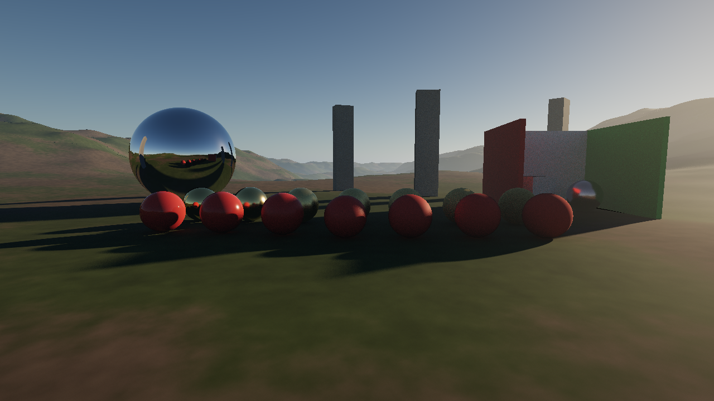

# Legacy Engine

Motor gráfico em **C++20 + Vulkan 1.3** com **ray tracing em tempo real**, feito para chegar no nível visual de RDR2 / GTA 6 / Cyberpunk 2077.



## O que já tem (Dia 1)

| Sistema | Técnica | Onde |
|---|---|---|
| RHI Vulkan moderno | Dynamic rendering, synchronization2, buffer device address, VMA | `src/rhi/` |
| Ray tracing | BLAS/TLAS + `VK_KHR_ray_query` | `src/rhi/accel.*` |
| Sombras | Traçadas por raio, penumbra física pelo disco solar | `shaders/forward.glsl` |
| Iluminação global | 1 rebote difuso traçado (sangramento de cor) | `shaders/forward.glsl` |
| Reflexões | Traçadas, amostragem VNDF do GGX (Dupuy & Benyoub 2023) | `shaders/brdf.glsl` |
| Materiais | PBR metálico/rugosidade: GGX + Smith correlacionado + Fresnel-Schlick | `shaders/brdf.glsl` |
| Céu | Atmosfera física Rayleigh/Mie/ozônio + sky-view LUT (Hillaire 2020) | `shaders/atmosphere.glsl` |
| Neblina | Névoa exponencial por altura com in-scattering do sol | `shaders/frame.glsl` |
| Câmera | Reverse-Z com plano distante infinito (precisão para mundo aberto) | `src/scene/camera.h` |
| Pipeline HDR | RGBA16F → acumulação temporal → ACES filmic | `src/renderer/` |
| Fallback | Roda sem ray tracing (sem sombras ainda) | `--no-rt` |

## Compilar

Requisitos: CMake 3.24+, compilador C++20, [Vulkan SDK](https://vulkan.lunarg.com/sdk/home) (traz o `glslangValidator`).
VMA, GLM e GLFW são baixados automaticamente.

```bash
cd engine
cmake -S . -B build -DCMAKE_BUILD_TYPE=Release
cmake --build build --config Release -j
```

No Windows, com Visual Studio 2022 instalado, os mesmos comandos funcionam (o executável fica em `build/Release/legacy.exe`).

GPU recomendada para ray tracing: NVIDIA RTX 20xx+, AMD RX 6000+ ou Intel Arc.

## Rodar

```bash
./build/legacy                 # janela interativa
./build/legacy --no-vsync      # sem limite de FPS
./build/legacy --validation    # liga as camadas de validação do Vulkan (debug)
./build/legacy --headless --frames 64 --width 1920 --height 1080 --out shot.png
```

Controles: **botão direito + mouse** olha · **WASD** move · **Q/E** desce/sobe · **Shift** rápido ·
**setas** movem o sol · **+/-** exposição · **Esc** sai.

Com a câmera parada a imagem converge (acumulação). Em movimento você vê 1 amostra por pixel, com ruído. O denoiser é o próximo passo.

## Arquitetura

```
src/
  rhi/        camada fina sobre Vulkan (contexto, recursos, pipelines, swapchain, BLAS/TLAS)
  scene/      malhas, materiais, câmera, cena de demonstração
  renderer/   organização dos passes do frame
  util/       PNG
shaders/      GLSL -> SPIR-V compilado no build
```

Passes por frame: `Sky LUT (compute) → Forward HDR + ray queries → Céu → Acumulação (compute) → Tonemap`.

## Roadmap

Em ordem: cada etapa destrava a próxima.

1. **Denoiser + TAA**: reprojeção temporal com motion vectors e um filtro estilo SVGF/ReLAX. Tira o ruído em movimento.
2. **Assets reais**: carregar glTF 2.0 com texturas (albedo, normal, ORM), mipmaps, compressão BC7, descritores bindless.
3. **Pós-processamento de cinema**: bloom físico, auto-exposição por histograma, profundidade de campo, motion blur, color grading por LUT.
4. **Upscaling**: DLSS / FSR 3 / XeSS (renderizar em resolução menor e reconstruir).
5. **GI de verdade**: ReSTIR DI (milhares de luzes com sombra) e ReSTIR GI / radiance cache multi-rebote, a direção do Lumen e do RTX Global Illumination.
6. **Geometria massiva**: GPU-driven rendering, culling em compute, mesh shaders, meshlets com LOD contínuo (a ideia do Nanite).
7. **Mundo aberto**: terreno com clipmaps e streaming, vegetação instanciada com vento, nuvens volumétricas, ciclo dia/noite, clima.
8. **Pele, cabelo e água**: subsurface scattering, strands de cabelo, oceano FFT.
9. **Path tracing completo** como modo "Overdrive" (como o Cyberpunk RT Overdrive).
